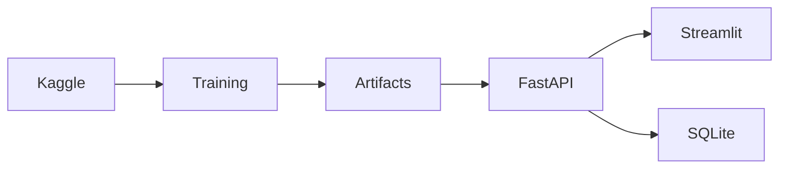

# CardioPredict-X
Research-only explainable cardiovascular classification. Not a clinically validated diagnosis or future risk model.

## Local setup (Python 3.11)
```sh
python3 -m venv .venv
source .venv/bin/activate
pip install -r requirements.txt
python -m ml.train
```
On macOS, if LightGBM/XGBoost requires OpenMP, install `brew install libomp`. If Kaggle download fails, download the CSV from https://www.kaggle.com/datasets/redwankarimsony/heart-disease-data and run `python -m ml.train --csv /path/to/heart_disease_uci.csv`. Original dataset: https://archive.ics.uci.edu/dataset/45/heart+disease.

In separate terminals with the environment active:
```sh
uvicorn backend.main:app --port 8000
streamlit run app.py
```
Dashboard: http://localhost:8501. API docs: http://localhost:8000/docs. Tests: `python -m pytest -q`. Docker: train locally first, then `docker compose up --build`.

## Architecture

Seven model candidates, training-only CV selection, logistic regression Optuna search, calibrated final classifier, bootstrap ensemble spread and ROC-AUC interval. Held-out center estimates are conditional on pooled model selection, not fully independent external validation. SHAP uses a small background sample and approximate Kernel SHAP. Missing values are imputed; range/category checks are heuristic OOD checks. History off unless ENABLE_HISTORY=1 plus per-request opt-in. Do not expose API publicly without authentication, access controls and HTTPS. For hosted deployment, use separate API and dashboard services, set API_URL and provide generated artifacts to both. Dataset browsing currently requires local dataset artifact access.

## Verification and limitations
No actual dataset metrics are bundled. Run training to generate results. Global SHAP beeswarm/waterfall, full Optuna search for each model, feature-level what-if explanation differences, and comprehensive clinical validation are not implemented. No clinical use. The dashboard requires Streamlit installation and has not been browser-tested in the authoring environment.
